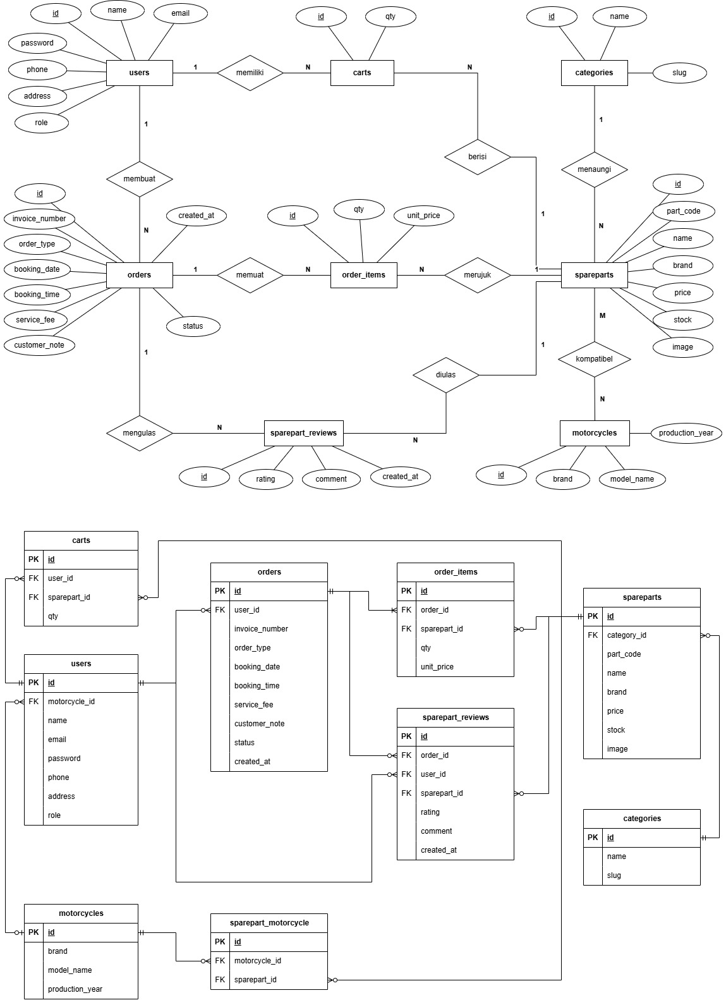

# MotoPart Store

Aplikasi e-commerce suku cadang motor dan pemesanan jadwal pemasangan bengkel berbasis Laravel 12. Pelanggan dapat mencari suku cadang yang sesuai dengan tipe motor di garasi profilnya, memilih pembelian langsung atau pemasangan di bengkel sesuai kuota sesi jam mekanik, dan memberikan ulasan terverifikasi setelah pesanan selesai.

## Fitur Utama

### Pelanggan
- **Filter Garasi Motor:** Menyimpan tipe motor utama pada profil atau memilih motor di beranda dan katalog untuk menyaring suku cadang yang kompatibel melalui relasi many-to-many.
- **Katalog dan Detail Produk:** Pencarian berdasarkan nama, kode SKU, atau merek, filter kategori, informasi stok real-time, rata-rata rating, dan ulasan pembeli terverifikasi.
- **Keranjang dan Checkout Bengkel:** Mendukung dua metode pemesanan, yaitu `beli_saja` (tanpa biaya jasa) dan `pasang_bengkel` (biaya jasa Rp 25.000 per item). Pemesanan bengkel memilih tanggal kedatangan dan sesi jam (`09:00 - 11:00`, `13:00 - 15:00`, `15:30 - 17:30`) dengan batas kuota maksimal 2 motor per sesi dan pemeriksaan slot langsung via endpoint `/booking-slots`.
- **Riwayat Pesanan dan Ulasan:** Pembatalan mandiri untuk pesanan berstatus `pending` yang otomatis mengembalikan stok produk, serta pengisian rating dan komentar untuk pesanan berstatus `selesai`.
- **Lupa dan Reset Password:** Permintaan tautan reset password lewat email dengan `throttle:6,1` serta respons netral untuk mencegah enumerasi akun terdaftar.

### Admin
- **Dashboard Ringkasan:** Statistik total sparepart, total pesanan, pesanan pending, total pelanggan, pesanan terbaru, dan daftar peringatan stok menipis (`stock < 5`).
- **Manajemen Data Master:** CRUD kategori, tipe motor, dan sparepart termasuk pemetaan kompatibilitas motor dan unggahan gambar produk ke storage publik.
- **Manajemen Pesanan:** Filter status/tipe pesanan, pencarian nomor invoice atau nama pelanggan, serta pembaruan status pesanan dengan `lockForUpdate` di dalam transaksi database agar perubahan status dan pengembalian stok saat pembatalan tetap aman dari race condition.
- **Notifikasi Email Status Pesanan:** Ketika admin mengubah status pesanan, aplikasi mengantrekan email pembaruan status ke alamat email pelanggan.

## Framework

- **Backend:** PHP 8.2+, Laravel 12
- **Database:** MySQL 8.4 (produksi / Docker) atau SQLite (pengembangan lokal)
- **Antrean dan Cache:** Redis 7 (Docker) atau driver `database` (lokal)
- **Frontend:** Blade Templates, Bootstrap 5.3, Bootstrap Icons
- **Email:** Symfony Mailgun Mailer (`symfony/mailgun-mailer`, `symfony/http-client`)
- **Pengujian dan Kontainer:** PHPUnit 11, Docker, Docker Compose

## Instalasi Lokal

1. Pastikan PHP 8.2+, Composer, dan ekstensi database (SQLite atau MySQL) sudah terpasang.
2. Instal dependensi PHP:
   ```bash
   composer install
   ```
3. Salin berkas environment dan buat application key:
   ```bash
   cp .env.example .env
   php artisan key:generate
   ```
4. Atur koneksi database pada `.env` (default `.env.example` memakai SQLite di `database/database.sqlite`, atau sesuaikan `DB_CONNECTION=mysql` jika menggunakan MySQL).
5. Jalankan migrasi dan pengisian data awal:
   ```bash
   php artisan migrate --seed
   ```
6. Buat symbolic link agar gambar produk dan aset publik bisa diakses:
   ```bash
   php artisan storage:link
   ```
7. Jalankan server pengembangan dan worker antrean email di dua terminal terpisah:
   ```bash
   php artisan serve
   php artisan queue:work
   ```
   Aplikasi dapat diakses di `http://127.0.0.1:8000`.

## Menjalankan dengan Docker Compose

Berkas `compose.yaml` menyiapkan empat layanan: `app` (PHP 8.4 Apache), `queue` (`queue:work` otomatis), `mysql` (MySQL 8.4), dan `redis` (Redis 7).

1. Pastikan berkas `.env` di root proyek sudah memiliki `APP_KEY` yang valid serta `DB_DATABASE`, `DB_USERNAME`, dan `DB_PASSWORD` (wajib terisi karena `compose.yaml` memerlukannya).
2. Bangun image dan jalankan seluruh kontainer:
   ```bash
   docker compose up -d --build
   ```
   Kontainer `app` otomatis menjalankan `php artisan migrate --force`, caching konfigurasi, rute, view, lalu menyalakan Apache di port `APP_PORT` (default `8000`).
3. Jalankan seeder ke database kontainer saat inisialisasi awal:
   ```bash
   docker compose exec app php artisan db:seed --force
   ```

## Konfigurasi Email (Mailgun HTTP API)

Aplikasi mendukung pengiriman email lewat Mailgun HTTP API (`mailgun+https`) maupun pencatatan lokal ke berkas log.

- Untuk pengembangan lokal tanpa mengirim email sungguhan, gunakan:
  ```env
  MAIL_MAILER=log
  ```
- Untuk mengaktifkan pengiriman nyata lewat Mailgun:
  ```env
  MAIL_MAILER=mailgun
  MAIL_FROM_ADDRESS="noreply@domain-anda.com"
  MAIL_FROM_NAME="MotoPart Store"
  MAILGUN_DOMAIN=domain-mailgun-anda.com
  MAILGUN_SECRET=key-api-mailgun-anda
  MAILGUN_ENDPOINT=api.mailgun.net
  ```
  Jika akun Mailgun memakai wilayah Eropa, ubah `MAILGUN_ENDPOINT` menjadi `api.eu.mailgun.net`. Karena pengiriman email menggunakan queue (`ShouldQueue`), pastikan proses `php artisan queue:work` (lokal) atau layanan `queue` (Docker Compose) sedang berjalan.

## Akun Demo dan Data Awal (`DatabaseSeeder`)

`DatabaseSeeder` bersifat idempoten (`updateOrCreate` dan `firstOrCreate`) sehingga aman dijalankan ulang tanpa menduplikasi data.

### Akun Login

Password untuk seluruh akun demo di bawah ini adalah `password`:

| Peran | Nama | Email | Motor Utama |
| :--- | :--- | :--- | :--- |
| Admin | Admin MotoPart | `admin@spareshop.web.id` | - |
| Pelanggan | Budi Santoso | `budi@spareshop.web.id` | Honda Vario 150 |
| Pelanggan | Siti Rahmawati | `siti@spareshop.web.id` | Yamaha NMAX 155 |
| Pelanggan | Andi Pratama | `andi@spareshop.web.id` | Yamaha Aerox 155 |
| Pelanggan | Rina Kusuma | `rina@spareshop.web.id` | Honda Scoopy Prestige |
| Pelanggan | Dimas Saputra | `dimas@spareshop.web.id` | Honda PCX 160 |
| Pelanggan | Maya Putri | `maya@spareshop.web.id` | Yamaha Fazzio Hybrid 125 |

### Skenario Data yang Disiapkan

- **4 kategori dan 8 tipe motor:** Oli & Pelumas, Sistem Pengereman, Komponen CVT, dan Kelistrikan & Aki; mencakup motor Honda, Yamaha, dan Suzuki.
- **16 produk suku cadang (4 per kategori):** Sudah cukup untuk menampilkan pagination di panel Admin (`paginate(10)`). Mencakup 1 produk habis stok (`CVT-BRT-10G`, stok `0`) dan total 5 produk stok menipis (`stock < 5`) untuk menguji tampilan peringatan stok di dashboard.
- **14 pesanan lintas status:** Terdiri atas status `pending`, `diproses`, `selesai`, dan `batal`, termasuk 2 pesanan aktif (`INV-20261115-PRCS` dan `INV-20261116-PRCS`) pada tanggal besok (`H+1`) sesi `13:00 - 15:00` sehingga kuota sesi tersebut (`2/2`) langsung penuh saat pengujian booking di `/cart`.
- **18 ulasan terverifikasi:** Terhubung ke item pada pesanan berstatus `selesai`, sementara 3 produk dibiarkan tanpa ulasan agar variasi rating dan kondisi belum ada ulasan sama-sama terlihat.

## Skema Database

Diagram di bawah ini menampilkan Entity Relationship Diagram (ERD) notasi Chen pada bagian atas serta Relasi Antar Tabel (RAT) notasi Crow's Foot pada bagian bawah:



## Pengujian

Jalankan seluruh pengujian fitur menggunakan PHPUnit (menggunakan SQLite `:memory:` sesuai `phpunit.xml`):

```bash
php artisan test
```
